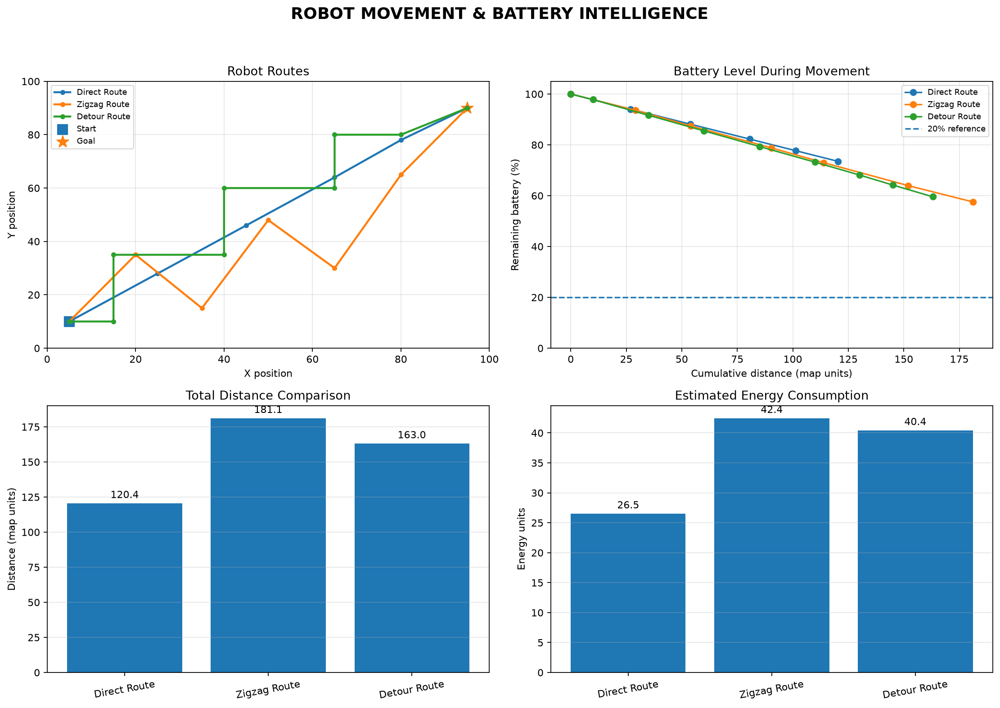
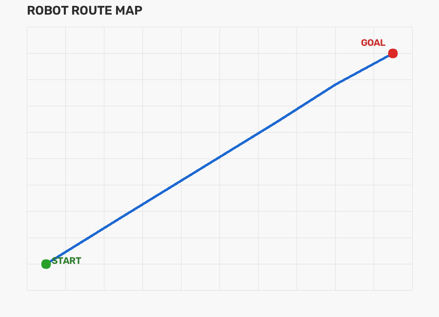

# 🤖 Robot Movement & Battery Intelligence Dashboard

A Python-based robotics simulation project that compares robot movement routes, estimates battery consumption, and visualizes performance using data science and computer vision libraries.

## 📌 Project Overview

This project simulates a robot moving between a starting point and a destination using three different routes. It analyzes the distance traveled, direction changes, estimated energy consumption, and remaining battery percentage.

The goal is to demonstrate how Python, numerical computation, data visualization, and image processing can be combined to investigate robotics problems.

## ✨ Features

- 🤖 Simulates three robot movement routes.
- 🔋 Estimates energy consumption and remaining battery.
- 📏 Calculates total travel distance using NumPy.
- 📊 Generates a four-panel Matplotlib dashboard.
- 🗺️ Uses OpenCV to draw and save a robot route map.
- 📁 Exports simulation results to a CSV file.
- 📈 Compares route distance and estimated energy usage.

## 🛠️ Technologies Used

- Python
- NumPy
- Matplotlib
- OpenCV
- CSV and pathlib (Python standard library)

## 📷 Project Screenshots

### Robot Data Science Dashboard



### Robot Route Map



## 🚀 Installation and Usage

### 1. Clone the repository

```bash
git clone https://github.com/shahadat-debug/Robot-battery-intelligence.git
cd Robot-battery-intelligence
```

### 2. Install the required libraries

```bash
python -m pip install numpy matplotlib opencv-python
```

### 3. Run the project

```bash
python robot_battery_intelligence.py
```

The program generates a dashboard, a route map, and a CSV data file inside the `output` folder.

## 📊 Analysis Performed

The simulation compares:

- Total distance traveled by each route.
- Number of detected direction changes.
- Estimated energy consumption.
- Remaining battery percentage.
- Battery level over cumulative travel distance.

## ⚠️ Limitations

This is a simulation, not a physical robot controller or a trained machine-learning model. Energy consumption is estimated using an illustrative formula, and the results do not represent real hardware measurements.

The lowest-energy route is selected according to the simulation model; obstacle avoidance, collision risk, terrain, and real-world motor efficiency are not yet considered.

## 🔮 Future Improvements

- Add obstacle detection and avoidance.
- Introduce more realistic battery and motor models.
- Use OpenCV to track a colored target through a webcam.
- Compare additional route-planning algorithms.
- Connect the simulation to a physical robot.
- Develop an interactive dashboard.

## 👨‍💻 Author

**Shahadat Ali**

Software Engineering Student | Python | Data Science | Computer Vision | Robotics

GitHub: https://github.com/shahadat-debug

---

*Built as a learning project to explore the intersection of Python, data analysis, computer vision, and robotics.*# Robot-battery-intelligence
A Python project for robot movement simulation, battery analysis, and data visualization.
